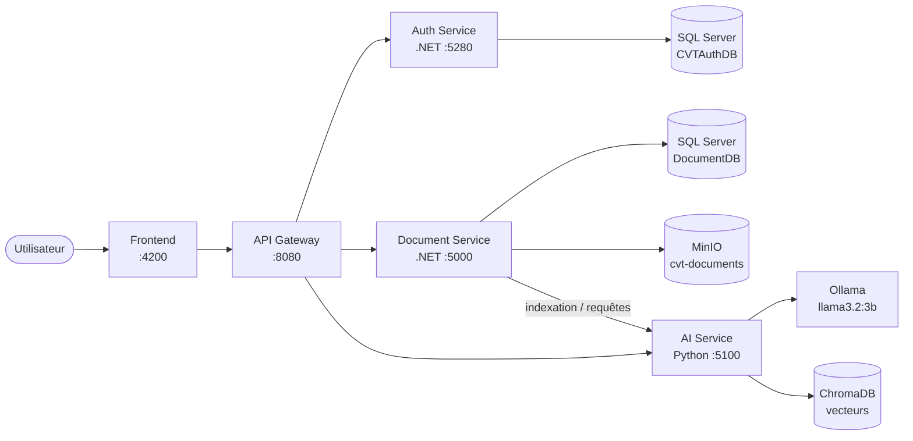

# CVT Knowledge AI


Plateforme de **gestion documentaire intelligente** reposant sur une architecture **microservices**. Elle permet de stocker des documents, de les indexer dans une base vectorielle et d'interroger cette base de connaissances en langage naturel grâce à un **LLM exécuté localement** (Ollama), sans dépendance à une API cloud externe.

---

## Sommaire

- [Fonctionnalités](#fonctionnalités)
- [Architecture](#architecture)
- [Stack technique](#stack-technique)
- [Structure du dépôt](#structure-du-dépôt)
- [Prérequis](#prérequis)
- [Démarrage rapide](#démarrage-rapide)
- [Configuration](#configuration)
- [Services et ports](#services-et-ports)
- [Sécurité](#sécurité)
- [Documentation](#documentation)
- [Pistes d'amélioration](#pistes-damélioration)
- [Auteur](#auteur)

---

## Fonctionnalités

- **Authentification sécurisée** par jetons JWT (émetteur, audience et durée d'expiration configurables)
- **Gestion de documents** : envoi, stockage et récupération de fichiers via un stockage objet compatible S3
- **Recherche sémantique et questions-réponses** sur les documents grâce à une approche RAG (*Retrieval-Augmented Generation*)
- **LLM local** : génération de réponses avec `llama3.2:3b` via Ollama, pour garder les données en interne
- **Historique des conversations** persisté côté service IA
- **API Gateway** comme point d'entrée unique vers les services
- **Interface web** dédiée (`cvt-frontend`)
- **Déploiement en une commande** avec Docker Compose

## Architecture



**Principe de fonctionnement :**

1. L'utilisateur s'authentifie auprès de l'**Auth Service**, qui délivre un JWT.
2. Le **Document Service** valide le jeton, enregistre les métadonnées dans SQL Server et stocke les fichiers dans **MinIO**.
3. Le contenu est transmis à l'**AI Service**, qui le vectorise et l'enregistre dans **ChromaDB**.
4. À chaque question, l'AI Service récupère les passages les plus pertinents et les fournit au LLM local (**Ollama**) pour produire une réponse contextualisée.

## Stack technique

| Couche | Technologies |
|---|---|
| Frontend | Application web (Nginx en production) |
| Passerelle | API Gateway .NET |
| Services métier | ASP.NET Core (Auth Service, Document Service) |
| Service IA | Python, ChromaDB, Ollama (`llama3.2:3b`) |
| Base de données | SQL Server 2022 |
| Stockage objet | MinIO (compatible S3) |
| Authentification | JWT |
| Conteneurisation | Docker, Docker Compose |

## Structure du dépôt

```text
cvt-knowledge-ai/
├── ApiGateway/             # Passerelle d'API
├── AuthService/            # Service d'authentification (JWT)
├── DocumentService/        # Gestion des documents (SQL Server + MinIO)
├── AiService/              # Service IA : RAG, ChromaDB, client Ollama
├── cvt-frontend/           # Interface web
├── docker-compose.yml      # Orchestration de l'ensemble des services
├── Stage-Charaf_AZIZI.pdf  # Rapport de stage
└── README.md
```

## Prérequis

- [Docker](https://docs.docker.com/get-docker/) ≥ 20.10 et Docker Compose v2
- **8 Go de RAM minimum** recommandés (SQL Server + Ollama en parallèle)
- ~10 Go d'espace disque (images, modèle LLM, volumes)
- Git

## Démarrage rapide

```bash
# 1. Cloner le dépôt
git clone https://github.com/CharafAZIZI/cvt-knowledge-ai.git
cd cvt-knowledge-ai

# 2. Configurer les variables d'environnement
cp .env.example .env        # puis modifier les valeurs (voir section Configuration)

# 3. Construire et lancer tous les services
docker compose up -d --build

# 4. Télécharger le modèle LLM dans Ollama (première exécution uniquement)
docker exec -it cvt-ollama ollama pull llama3.2:3b

# 5. Vérifier l'état des conteneurs
docker compose ps
```

Une fois les services démarrés :

| Accès | URL |
|---|---|
| Application web | http://localhost:4200 |
| API Gateway | http://localhost:8080 |
| Console MinIO | http://localhost:9001 |

Pour arrêter la plateforme : `docker compose down` (ajoutez `-v` pour supprimer aussi les volumes de données).

## Configuration

Les paramètres sensibles doivent être externalisés dans un fichier `.env` **non versionné**. Exemple de `.env.example` :

```env
# SQL Server
MSSQL_SA_PASSWORD=<mot_de_passe_fort>

# JWT
JWT_KEY=<chaine_aleatoire_de_64_caracteres_minimum>
JWT_ISSUER=CVTAuthService
JWT_AUDIENCE=CVTAdministration
JWT_EXPIRATION_MINUTES=120

# MinIO
MINIO_ROOT_USER=<utilisateur>
MINIO_ROOT_PASSWORD=<mot_de_passe_fort>
MINIO_BUCKET=cvt-documents

# Service IA
AI_OLLAMA_MODEL=llama3.2:3b
```

Variables principales utilisées par les services :

| Service | Variable | Rôle |
|---|---|---|
| Auth / Document | `ConnectionStrings__DefaultConnection` | Connexion à SQL Server (`CVTAuthDB`, `DocumentDB`) |
| Auth / Document | `Jwt__Key`, `Jwt__Issuer`, `Jwt__Audience` | Signature et validation des jetons (identiques entre services) |
| Document | `Minio__Endpoint`, `Minio__AccessKey`, `Minio__SecretKey`, `Minio__BucketName` | Accès au stockage objet |
| Document | `AiService__BaseUrl` | URL interne du service IA |
| AI | `AI_OLLAMA_BASE_URL`, `AI_OLLAMA_MODEL` | Serveur et modèle Ollama |
| AI | `AI_CHROMA_PERSIST_DIR` | Répertoire de persistance de ChromaDB |

## Services et ports

| Service | Conteneur | Port hôte | Description |
|---|---|---|---|
| Frontend | `cvt-frontend` | `4200` | Interface utilisateur |
| API Gateway | `cvt-api-gateway` | `8080` | Point d'entrée unique |
| Auth Service | `cvt-auth-service` | `5280` | Authentification et JWT |
| Document Service | `cvt-document-service` | `5000` | Gestion des documents |
| AI Service | `cvt-ai-service` | `5100` | RAG et interface avec le LLM |
| Ollama | `cvt-ollama` | `11434` | Serveur de modèles LLM |
| MinIO | `cvt-minio` | `9000` / `9001` | API S3 / console web |
| SQL Server | `cvt-sqlserver` | `1433` | Base de données relationnelle |

**Volumes persistants :** `sqlserver_data`, `minio_data`, `ollama_data`, `chroma_data`, `ai_model_cache`, `ai_history_data`.

## Sécurité

- Ne versionnez jamais de mots de passe, clés JWT ou identifiants MinIO : utilisez un fichier `.env` listé dans `.gitignore`.
- Utilisez une clé JWT longue, aléatoire et unique par environnement.
- En production, n'exposez que l'API Gateway et le frontend ; les ports de SQL Server, MinIO, Ollama et des services internes ne doivent pas être publics.
- Remplacez `ASPNETCORE_ENVIRONMENT=Development` par `Production` pour un déploiement réel.
- Activez HTTPS (reverse proxy Nginx / Traefik) devant la passerelle.

## Documentation

- [`Stage-Charaf_AZIZI.pdf`](./Stage-Charaf_AZIZI.pdf) : rapport de stage décrivant le contexte, la conception et la réalisation du projet

## Pistes d'amélioration

- Pipeline **CI/CD** avec GitHub Actions (build, tests, scan des images)
- **Health checks** et ordre de démarrage fiable dans Docker Compose
- Gestion des rôles et permissions par document
- Support de modèles LLM plus puissants et accélération GPU pour Ollama
- Tests automatisés (unitaires et d'intégration) pour chaque service
- Supervision centralisée (logs, métriques)

## Auteur

**Charaf AZIZI**
GitHub : [@CharafAZIZI](https://github.com/CharafAZIZI)